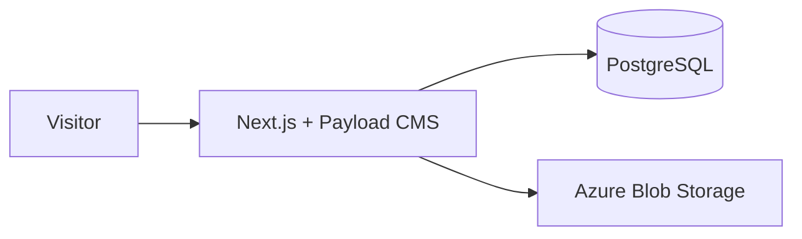

# The Offhand

A Next.js 15 and Payload CMS publication. PostgreSQL stores content; Azure Blob Storage stores media.

## Requirements

- Node.js 20+
- PostgreSQL
- Azure Blob Storage account/container

## Run locally

Copy `.env.example` to `.env` and fill in the database, Payload secret, and Azure Storage values. `NEXT_PUBLIC_SITE_URL` defaults to `http://localhost:3000`; `AZURE_STORAGE_CONTAINER_NAME` defaults to `media`.

```sh
npm ci
npx payload migrate
npm run dev
```

Open `http://localhost:3000` (admin: `/admin`).

## Repository

```text
src/
  app/(frontend)/   Public pages and layout
  app/(payload)/    Payload admin and API routes
  collections/      Posts, users, and media
  globals/          Site-wide settings
  migrations/       Versioned database changes
  payload.config.ts CMS and database configuration
.github/workflows/  Build and Azure deployment
Dockerfile          Production container
```

## Useful commands

```sh
npm run dev                 # Local development
npm run build               # Production build
npm start                   # Run the production build
npx tsc --noEmit            # Type-check
npx payload migrate:status  # Check database migrations
npx payload migrate         # Apply pending migrations
npx payload migrate:create # Create a migration after schema changes
npm run generate:types      # Regenerate Payload TypeScript types
npm run generate:importmap  # Regenerate Payload admin imports
```

Keep applied migrations: they are the database’s schema history.

## Architecture


